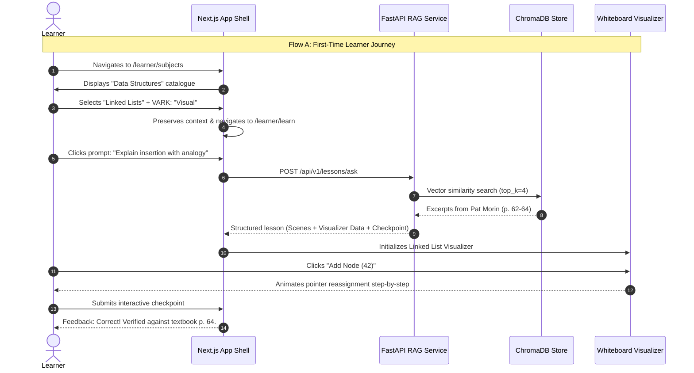

# EduNex — High-Fidelity Wireframe Specification & Product Design Document

**Product Name:** EduNex  
**Tagline:** *"Turns Learning Gaps into Personalized Growth."*  
**Scope:** Complete UX/UI Architecture, High-Fidelity Wireframes, Reusable Component Inventory, Interactive Visualizer Specification, and User Journey Maps.  
**Primary Focus Topic for MVP:** Data Structures &rarr; Linked Lists.

---

## 1. Information Architecture (IA)

EduNex is structured into two mutually exclusive, dedicated workspaces: **Learner Workspace** (6 core pages) and **Admin Workspace** (5 core pages), with a decoupled authentication entry.

```
EduNex Platform
├── Authentication (Standalone)
│   ├── /auth/login                 [Sign In]
│   └── /auth/register              [Create Account - Proposal Only]
│
├── Learner Workspace (/learner)
│   ├── /learner/dashboard          [Dashboard: Feeds, Learning Path, Quick Resume]
│   ├── /learner/subjects           [Explore Subjects: Catalogue & VARK Preferences]
│   ├── /learner/learn              [Learn with AI: State A (Initial) & State B (Active Whiteboard)]
│   ├── /learner/practice           [Practice & Assessments: Quiz Engine & Feedback]
│   ├── /learner/progress           [My Progress: Topic Mastery, Gaps, Recommendations]
│   └── /learner/saved-lessons      [Saved Lessons: Bookmarks & Session Resume]
│
└── Admin Workspace (/admin)
    ├── /admin/dashboard            [Admin Overview: System Health, Job Queues, Quick Actions]
    ├── /admin/users                [User Management: Account Status, Roles, Auditing]
    ├── /admin/courses              [Subject & Course Management: Catalog & Topics]
    ├── /admin/knowledge-base       [Academic Content & RAG: Ingestion Pipeline & Search Test]
    └── /admin/analytics-settings   [Platform Analytics & System Configuration]
```

---

## 2. Design System & Design Tokens Specification

### 2.1 Warm Academic Palette
The aesthetic is warm, scholarly, focused, and restrained. It avoids generic tech gradients, neon highlights, and distracting decorative animations.

| Token | Hex Value | Role / Usage | Contrast Ratio on White / Canvas |
| :--- | :--- | :--- | :--- |
| `--color-bg-canvas` | `#FAF7F2` | Primary page & viewport background | Base |
| `--color-bg-card` | `#FFFFFF` | Card surfaces, modals, whiteboard canvas | 1.05:1 vs Canvas |
| `--color-bg-surface-warm` | `#F4EFEA` | Secondary surfaces, hover states, code block bg | 1.15:1 vs Canvas |
| `--color-text-primary` | `#292824` | Headings, labels, primary body text | 12.8:1 (AAA) |
| `--color-text-secondary` | `#77736C` | Metadata, subtitles, helper text, borders | 4.8:1 (AA) |
| `--color-accent-primary` | `#B96F52` | Primary CTAs, active sidebar pills, focus rings | 4.6:1 (AA) |
| `--color-accent-secondary` | `#D9A441` | Badges, warning indicators, checkpoint markers | 3.2:1 (large text) |
| `--color-border-subtle` | `#E8E0D6` | Card borders, table dividers, panel splitters | Structural divider |
| `--color-border-focus` | `#B96F52` | 2px solid accessible keyboard outline | Visible focus |
| `--color-status-success` | `#2E6B4F` | Correct answers, indexed status, progress | 5.2:1 (AA) |
| `--color-status-error` | `#A63A2F` | Incorrect attempts, failed ingestion, validation | 5.4:1 (AA) |

### 2.2 Typography Scale
- **Font Family (Sans):** Plus Jakarta Sans / Inter (`system-ui, -apple-system, sans-serif`)
- **Font Family (Mono):** JetBrains Mono / SF Mono (`ui-monospace, monospace`)

| Token | Size | Line Height | Weight | Usage |
| :--- | :--- | :--- | :--- | :--- |
| `--text-display` | `32px` | `40px` | 700 (Bold) | Dashboard welcome, hero headings |
| `--text-h1` | `24px` | `32px` | 700 (Bold) | Page titles |
| `--text-h2` | `20px` | `28px` | 600 (Semibold)| Section headers, modal titles |
| `--text-h3` | `16px` | `24px` | 600 (Semibold)| Card titles, whiteboard block headers |
| `--text-body` | `15px` | `22px` | 400 (Regular) | Primary paragraphs, explanations |
| `--text-small` | `13px` | `18px` | 500 (Medium) | Metadata, captions, badges |
| `--text-code` | `13px` | `20px` | 400 (Regular) | Inline code, pointer references |

### 2.3 Spacing & Elevation
- **Spacing Scale:** 4px (`0.25rem`), 8px (`0.5rem`), 12px (`0.75rem`), 16px (`1rem`), 24px (`1.5rem`), 32px (`2rem`), 48px (`3rem`).
- **Corner Radii:**
  - Badges/Pills: `9999px`
  - Buttons & Inputs: `8px` (`var(--radius-sm)`)
  - Cards & Panels: `12px` (`var(--radius-md)`)
  - Modals & Whiteboard Container: `16px` (`var(--radius-lg)`)
- **Shadows:**
  - `--shadow-card`: `0 1px 3px rgba(41, 40, 36, 0.05), 0 1px 2px rgba(41, 40, 36, 0.03)`
  - `--shadow-elevated`: `0 10px 25px -5px rgba(41, 40, 36, 0.08), 0 8px 10px -6px rgba(41, 40, 36, 0.04)`

---

## 3. Global Application Shell

```
+-------------------------------------------------------------------------------------------------------+
|  [Logo] EduNex               Breadcrumb: Subjects > Data Structures > Linked Lists       [Profile (v)]|
+-------------------+-----------------------------------------------------------------------------------+
|  LEARNER NAV      |  PAGE HEADER: Learn with AI                                                       |
|  [x] Dashboard    |  Topic: Linked Lists | Goal: Insertion & Pointers | VARK: Visual                  |
|  [ ] Explore      +---------------------------------------------------+-------------------------------+
|  [ ] Learn w/ AI  |                                                   |  AI TUTOR ASSISTANT           |
|  [ ] Practice     |  CENTRAL WORKSPACE / WHITEBOARD                   |  - Context: Linked Lists      |
|  [ ] My Progress  |  (State A: Discovery OR State B: Active Session)  |  - Message Stream             |
|  [ ] Saved        |                                                   |  - Prompt Input               |
|                   |                                                   |  - Action Buttons             |
|  ---------------- |                                                   |                               |
|  [?] Help         |                                                   |                               |
|  [Learner: Hasan] |                                                   |  [Send Prompt ->]             |
+-------------------+---------------------------------------------------+-------------------------------+
```

### 3.1 Shell Responsive Rules
- **Desktop (&ge; 1200px):** Permanent 260px left sidebar, fluid main region, sticky 360px right assistant panel on `/learner/learn`.
- **Tablet (768px – 1199px):** Sidebar collapses to a 68px icon rail. Right assistant collapses into a slide-over drawer triggered by a floating badge.
- **Mobile (&lt; 768px):** Header with hamburger toggle opens a full-height off-canvas navigation drawer. Whiteboard and chat panel stack into tabbed views (`[Whiteboard] | [Chat with AI]`).

---

## 4. Screen-by-Screen High-Fidelity Wireframes

---

### Learner Page 1: Dashboard (`/learner/dashboard`)

**Purpose:** Gives the learner an immediate, un-cluttered pulse of their active learning trajectory, concept bottlenecks, and immediate next steps.

```
+-------------------------------------------------------------------------------------------------------+
| SECTION A: WELCOME HERO BANNER                                                                        |
| "Welcome back, Hasan. You're mastering Linked List Pointers today."                                   |
| Subtitle: 2 milestones completed this week. Consistent practice builds permanent mental models.       |
| [ Primary CTA: Continue Active Lesson -> (Linked Lists: Pointer Operations) ]                         |
+-------------------------------------------------------------------------------------------------------+
| SECTION B: THREE LEARNING FEEDS (3-Column Grid)                                                       |
|                                                                                                       |
| [ FEED 1: WHAT AM I LEARNING? ]   [ FEED 2: WHERE AM I STRUGGLING? ]  [ FEED 3: WHAT CAN I DO NEXT? ] |
| - Active Topic: Linked Lists      - Flagged Concept: Pointer Reversal - Recommended Practice:         |
| - Subtopic: Singly vs Doubly      - Diagnostic: 2 incorrect answers   - "Reverse a Singly Linked List"|
| - Progress: 65% Completed         - Root Gap: Losing reference to     - Estimated Time: 12 minutes    |
| - Last Activity: 18 mins ago        next node before assignment       - Mode: Interactive Simulation  |
|                                                                                                       |
| [ Resume Lesson Button ]          [ Review Concept Deep-Dive ]        [ Start Recommended Activity ]  |
+-------------------------------------------------------------------------------------------------------+
| SECTION C: RECENT LEARNING SESSIONS                  | SECTION D: ACCREDITED TOPIC MASTERY            |
| - Singly Linked Lists: Insertion (Saved Yesterday)   | - Linked Lists: 72% Estimated Mastery          |
| - Arrays vs Linked Lists Memory Layout (2 days ago)  | - Stack Operations: 88% Mastered               |
| - Big-O Complexity of Traversals (3 days ago)        | - Binary Trees: Not Started                    |
| [ View All Saved Lessons -> ]                        | * Based on 24 verified assessment submissions. |
+-------------------------------------------------------------------------------------------------------+
```

#### Interaction Specifications & States:
1. **Continue Active Lesson CTA:** Click &rarr; routes directly to `/learner/learn` with preloaded state of `les_linked_list_01`.
2. **Review Concept Deep-Dive:** Click &rarr; opens `/learner/learn` with auto-prompted prompt: *"Explain step-by-step how pointer reference is preserved during node reversal without orphan nodes."*
3. **Empty / First-Time Learner State:** Section A shows *"Welcome to EduNex. Start your personalized learning journey."* Feeds 1, 2, and 3 display exploratory prompt cards: *"[Explore Subjects &rarr;]"*, with Data Structures pre-suggested.

---

### Learner Page 2: Explore Subjects (`/learner/subjects`)

**Purpose:** Discover academic domains, select a curriculum topic, and configure optional VARK multimodal learning preferences.

```
+-------------------------------------------------------------------------------------------------------+
| HEADER: Explore Subjects & Curriculum                                                                 |
| Search Field: [ Search topics, e.g. 'Pointers', 'Linked Lists', 'Sorting'...                     [Q] ]|
+-------------------------------------------------------------------------------------------------------+
| SECTION A: SUBJECT BROWSER                                                                            |
| [ Selected: Data Structures ]  [ Algorithms ]  [ Discrete Mathematics ]  [ Computer Systems ]         |
| 14 Topics Available            8 Topics        12 Topics                 6 Topics                     |
+-------------------------------------------------------------------------------------------------------+
| SECTION B: TOPICS IN "DATA STRUCTURES"                                                                |
|                                                                                                       |
| +------------------------------------+  +------------------------------------+                        |
| | Topic: Linked Lists      [ACTIVE]  |  | Topic: Arrays & Dynamic Memory     |                        |
| | Description: Sequential data nodes |  | Description: Contiguous allocations|                        |
| | connected via memory pointers.     |  | and indexing trade-offs.           |                        |
| | Level: Foundational to Intermediate|  | Level: Foundational                |                        |
| | Coverage: Singly, Doubly, Circular |  | Status: Completed                  |                        |
| | [ Selected for Study (v) ]         |  | [ View Topic Overview ]            |                        |
| +------------------------------------+  +------------------------------------+                        |
+-------------------------------------------------------------------------------------------------------+
| SECTION C: OPTIONAL LEARNING PREFERENCE SELECTOR (VARK Model)                                         |
| Subtitle: Customize how explanations and interactive simulations are synthesized.                    |
|                                                                                                       |
| [x] Visual                 [ ] Auditory             [ ] Read/Write           [x] Kinesthetic          |
| Animated diagrams, node    Spoken tutor narration   Detailed textual proofs  Interactive simulations, |
| flowcharts, pointer paths  and voice debriefs       and code annotations     step-by-step manipulations|
|                                                                                                       |
| [ Secondary: Reset to Default ]               [ Primary CTA: Start Learning with AI (Linked Lists) ->]|
+-------------------------------------------------------------------------------------------------------+
```

#### Interaction Specifications:
1. **Topic Select:** Clicking a card selects it as the active context and activates the Primary CTA.
2. **Preference Multi-Select:** Checkboxes toggle visual/kinesthetic badges without altering factual content.
3. **Primary CTA Execution:** Preserves selected topic (`Linked Lists`) and preferences in session storage &rarr; navigates to `/learner/learn` with immediate topic initialization.

---

### Learner Page 3: Learn with AI (`/learner/learn`)

#### STATE A: Initial Learning Workspace (No Active Session)

```
+-------------------------------------------------------------------+-----------------------------------+
| CENTRAL EXPLORATION DASHBOARD (Width: 65%)                        | RIGHT CHAT PANEL (Width: 35%)     |
|                                                                   |                                   |
| [Badge: Ready to Learn]                                           | [Tutor: EduNex AI Copilot]        |
| Heading: Explore Linked Lists with Your Personal AI Tutor         | Context: Linked Lists (General)   |
|                                                                   | --------------------------------- |
| How EduNex Works:                                                 | EduNex: "Hello Hasan! I'm grounded|
| 1. Every claim is retrieved from verified academic textbooks.     | in Pat Morin's Open Data          |
| 2. Concepts are translated into interactive visual simulations.   | Structures. What concept shall we |
| 3. Embedded checkpoints verify understanding at every step.       | break down first?"                |
|                                                                   |                                   |
| SUGGESTED PROMPTS TO START:                                       |                                   |
| [ "Explain Linked Lists using a simple train-car analogy." ]      |                                   |
| [ "Show me step-by-step how to insert a node at the head." ]      |                                   |
| [ "Why does inserting into a linked list take O(1) time?" ]       |                                   |
| [ "What happens to pointers when deleting the middle node?" ]     |                                   |
|                                                                   | --------------------------------- |
| RECENT RESUMABLE SESSION:                                         | Prompt Input:                     |
| "Linked List Memory Pointers & Reference Leaks" (Paused at Step 3)| [ Ask any question about pointers]|
| [ Resume Saved Session -> ]                                       | [Send Prompt Button (Arrow)]      |
+-------------------------------------------------------------------+-----------------------------------+
```

---

#### STATE B: Active Learning Session (Structured Lesson Whiteboard + Interactive Visualizer)

```
+-------------------------------------------------------------------+-----------------------------------+
| CENTRAL LESSON WHITEBOARD (Width: 65%)                            | RIGHT CHAT PANEL (Width: 35%)     |
| Header: Lesson: Singly Linked List Node Insertion                 |                                   |
| [ Progress: Step 2 of 4 ]  [ Bookmark / Save ]  [ Mark Complete ] | Tutor: "I've structured a lesson  |
| ----------------------------------------------------------------- | on node insertion with an         |
| BLOCK 1: CONCEPT DEFINITION                                       | interactive simulator."           |
| A Linked List is a linear collection of data elements called      |                                   |
| nodes, where linear order is given by pointers rather than        | Learner: "Show me what happens    |
| contiguous physical memory placement.                             | if new_node.next is omitted."     |
| Citation: Open Data Structures, Chap. 3, Pat Morin (p. 62)        |                                   |
|                                                                   | Tutor: "Observe the simulation on |
| BLOCK 2: INTERACTIVE LINKED LIST VISUALIZER                       | the left: omitting that pointer   |
| [ Add Node (+) ]  [ Delete Node (-) ]  [ Traverse (>) ]  [Reset]  | creates an orphan node."          |
|                                                                   |                                   |
| Node Structure: [ Value: 42 | Next: 0x8F ]                        |                                   |
|                                                                   |                                   |
|   HEAD                                                            |                                   |
|     |                                                             |                                   |
|     v                                                             |                                   |
|  +-------+---+     +-------+---+     +-------+---+                |                                   |
|  |  10   | o-----> |  25   | o-----> |  42   | X | [NULL]         |                                   |
|  +-------+---+     +-------+---+     +-------+---+                |                                   |
|   (Node 0)          (Node 1)          (Node 2: NEW)               |                                   |
|                                                                   |                                   |
| Operation Log:                                                    |                                   |
| 1. Allocated memory for new Node(42).                             |                                   |
| 2. Pointed Node(25).next -> Address of Node(42).                  |                                   |
| 3. Set Node(42).next = NULL. Traversal time: O(n).                | --------------------------------- |
|                                                                   | Prompt Input:                     |
| BLOCK 3: EMBEDDED CHECKPOINT QUESTION                             | [ Ask a clarifying question...   ]|
| Q: What is the consequence if the head pointer is reassigned      | [ Send Button ]                   |
|    before linking the new node to the old head?                   |                                   |
| ( ) The list remains valid and updates automatically              |                                   |
| (x) The remaining elements become unreachable orphan nodes        |                                   |
| ( ) Memory is immediately freed by the hardware compiler          |                                   |
| [ Submit Answer ] &rarr; [ Feedback: Correct! Verified p. 64 ]    |                                   |
+-------------------------------------------------------------------+-----------------------------------+
```

---

### Learner Page 4: Practice & Assessments (`/learner/practice`)

**Purpose:** Targeted diagnostic practice questions, code comprehension checks, and conceptual evaluations.

```
+-------------------------------------------------------------------------------------------------------+
| HEADER: Practice & Diagnostic Assessments                                                             |
| Filter by Subject: [ Data Structures (v) ] | Topic: [ Linked Lists (v) ] | Level: [ Intermediate (v) ]|
+-------------------------------------------------------------------------------------------------------+
| SECTION A: ASSESSMENT CARDS                                                                           |
|                                                                                                       |
| +------------------------------------+  +------------------------------------+                        |
| | Quiz: Singly vs Doubly Pointers    |  | Quiz: Node Deletion & Memory Leaks |                        |
| | 5 Questions | 10 mins | Foundational| | 4 Questions | 8 mins | Intermediate|                        |
| | Focus: Reference allocation rules  |  | Focus: Edge cases & empty lists    |                        |
| | [ Start Practice Session -> ]      |  | [ Start Practice Session -> ]      |                        |
| +------------------------------------+  +------------------------------------+                        |
+-------------------------------------------------------------------------------------------------------+
| SECTION B: ACTIVE ASSESSMENT MODAL / INTERFACE                                                        |
| Question 2 of 5                                                          [ Progress Bar: 40% ]        |
|                                                                                                       |
| Question:                                                                                             |
| You are inserting a new node `N` between node `A` and node `B` in a Singly Linked List.               |
| In which order must the pointer adjustments occur to prevent memory detachment?                       |
|                                                                                                       |
| [ ] Option A: `A.next = N`, then `N.next = B`                                                         |
| [x] Option B: `N.next = B`, then `A.next = N`                                                         |
| [ ] Option C: `B.next = N`, then `N.next = A`                                                         |
| [ ] Option D: Order does not matter in modern garbage-collected runtimes                              |
|                                                                                                       |
| [ Submit Answer ]                                                                                     |
|                                                                                                       |
| FEEDBACK REVEAL (POST-SUBMISSION):                                                                    |
| [ Status: Correct (✓) ]                                                                               |
| Detailed Rationale: Setting `N.next = B` first guarantees that the reference to `B` is maintained.    |
| If `A.next = N` is executed first, the reference to `B` is lost forever.                             |
| Citation: pat_morin_ods_chap3.pdf (p. 63)                                                             |
| [ Next Question (3/5) -> ]                                                                            |
+-------------------------------------------------------------------------------------------------------+
```

---

### Learner Page 5: My Progress (`/learner/progress`)

**Purpose:** Clear, uninflated view of student competence based solely on evaluated interactions.

```
+-------------------------------------------------------------------------------------------------------+
| HEADER: Learning Progress & Mastery Analytics                              [ Filter: Last 30 Days (v)]|
+-------------------------------------------------------------------------------------------------------+
| SECTION A: METRIC SUMMARY CARDS                                                                       |
| [ Topics Explored: 3 ]    [ Checkpoints Answered: 28 ]  [ Diagnostic Accuracy: 78.5% ]               |
| Active: Linked Lists      22 Correct / 6 Under Review   Verified through practice attempts            |
+-------------------------------------------------------------------------------------------------------+
| SECTION B: TOPIC MASTERY BREAKDOWN                                                                    |
| Topic                     Mastery Status      Last Tested       Action                                |
| ---------------------------------------------------------------------------------------------------   |
| Linked Lists: Basics      [ Strong (85%) ]    Oct 16, 2026      [ Review Notes ]                      |
| Linked Lists: Insertion   [ Progressing (70%)]Oct 17, 2026      [ Practice More ]                     |
| Linked Lists: Deletion    [ Needs Review (45%)]Oct 17, 2026     [ Launch AI Targeted Session ]        |
+-------------------------------------------------------------------------------------------------------+
| SECTION C: DIAGNOSED LEARNING GAPS & TARGETED RECOMMENDATIONS                                         |
| - Identified Gap: Boundary condition handling when deleting the head node in a single-element list.   |
| - Evidence: 2 incorrect assessment answers in "Node Deletion & Memory Leaks".                         |
| - Suggested Next Activity: 5-minute interactive simulation: "Handling Head Pointer Edge Cases".       |
| [ Start Recommended Activity Now -> ]                                                                 |
+-------------------------------------------------------------------------------------------------------+
```

---

### Learner Page 6: Saved Lessons (`/learner/saved-lessons`)

**Purpose:** Bookmarked, resumable lessons and historical interactive whiteboard states.

```
+-------------------------------------------------------------------------------------------------------+
| HEADER: Saved Lessons & Bookmarks                                                                     |
| Search: [ Search bookmarked lessons... ]           Filter: [ All Topics (v) ]  Sort: [ Recent (v) ]   |
+-------------------------------------------------------------------------------------------------------+
| SAVED LESSON CARDS (Grid View)                                                                        |
|                                                                                                       |
| +---------------------------------------------------------------------------------------------------+ |
| | Lesson: Singly Linked List Pointer Reversal                                                       | |
| | Subject: Data Structures | Topic: Linked Lists | Saved: Oct 17, 2026                              | |
| | Summary: Step-by-step 3-pointer algorithm (prev, curr, next) preventing orphan nodes.            | |
| | Checkpoint Status: 1/1 Completed | Includes Interactive Simulation State                          | |
| | [ Open Saved Whiteboard Session ]                      [ Remove Bookmark (Trash Icon) ]           | |
| +---------------------------------------------------------------------------------------------------+ |
|                                                                                                       |
| +---------------------------------------------------------------------------------------------------+ |
| | Lesson: Arrays vs Linked Lists: Memory & Cache Locality                                           | |
| | Subject: Data Structures | Topic: Linked Lists | Saved: Oct 15, 2026                              | |
| | Summary: CPU cache line advantages in contiguous arrays vs pointer dereferencing penalties.       | |
| | Checkpoint Status: Completed                                                                      | |
| | [ Open Saved Whiteboard Session ]                      [ Remove Bookmark (Trash Icon) ]           | |
| +---------------------------------------------------------------------------------------------------+ |
|                                                                                                       |
| EMPTY STATE (If no saved items):                                                                      |
| [ Bookmark Icon ]                                                                                     |
| "You haven't bookmarked any lessons yet."                                                             |
| Explore subjects and click 'Save Lesson' in the AI workspace to review simulations anytime.          |
| [ Browse Subjects -> ]                                                                                |
+-------------------------------------------------------------------------------------------------------+
```

---

### Admin Page 1: Admin Dashboard (`/admin/dashboard`)

**Purpose:** Real-time visibility into ingestion pipelines, generation job queues, and vector database status.

```
+-------------------------------------------------------------------------------------------------------+
| ADMIN HEADER: Platform Operations & System Health                                                     |
| [ Engine: Connected (v2.0) ]  [ Vector Store: 28 Chunks ]  [ Media Store: 100% Operational ]          |
+-------------------------------------------------------------------------------------------------------+
| SECTION A: OPERATIONAL METRICS (Live DB Queries Only)                                                 |
| [ Verified Sources: 6 ]     [ Total Chunks: 28 ]      [ Cache Hit Rate: 66.7% ] [ Active Jobs: 0 ]    |
| All OpenStax & OER Books    ChromaDB Cosine Space     2 Hits / 3 Requests       Worker Queue Clean    |
+-------------------------------------------------------------------------------------------------------+
| SECTION B: RECENT SYSTEM ACTIVITY & GENERATION JOBS                                                   |
| Job ID       Query                          Status       Duration   Cache Hit   Timestamp             |
| ---------------------------------------------------------------------------------------------------   |
| job_8f912c   "What is Newton Second Law"    COMPLETED    1.4s       Yes (Hit)   15:10:04              |
| job_33a019   "Explain Python Functions"     COMPLETED    3.8s       No (Miss)   15:08:12              |
| job_09eb41   "Capital of Atlantis"          ABSTAINED    0.2s       No (Miss)   15:06:55              |
+-------------------------------------------------------------------------------------------------------+
| SECTION C: QUICK ADMINISTRATIVE ACTIONS                                                               |
| [ Add New Academic Source ]   [ Trigger Full Re-Index ]   [ View ChromaDB Chunks ]  [ Export Logs ]   |
+-------------------------------------------------------------------------------------------------------+
```

---

### Admin Page 2: User Management (`/admin/users`)

**Purpose:** Manage role permissions (Learner vs Administrator) and audit user engagement.

```
+-------------------------------------------------------------------------------------------------------+
| ADMIN HEADER: User Accounts & Authorization                                                           |
| Search: [ Search users by name or ID... ]    Role Filter: [ All Roles (v) ]  Status: [ Active (v) ]   |
+-------------------------------------------------------------------------------------------------------+
| USERS TABLE                                                                                           |
| User Name       Role          Account Status   Joined Date    Lessons Explored   Actions              |
| ---------------------------------------------------------------------------------------------------   |
| Hasan Musamji   Learner       Active           Oct 17, 2026   18 Sessions        [ Edit ] [ Suspend ] |
| Mukhtar Momin   Administrator Active           Oct 15, 2026   N/A (Admin)        [ Edit Role ]        |
| Ahsan Builds    Learner       Active           Oct 16, 2026   6 Sessions         [ Edit ] [ Suspend ] |
+-------------------------------------------------------------------------------------------------------+
| DRAWER / MODAL: EDIT USER ROLE                                                                        |
| User: Hasan Musamji (ID: usr_0192)                                                                    |
| Role: (o) Learner   ( ) Administrator                                                                 |
| Note: Administrators have complete access to vector indexing and system settings.                     |
| [ Cancel ]                                                  [ Save Authorization Changes ]            |
+-------------------------------------------------------------------------------------------------------+
```

---

### Admin Page 3: Subject & Course Management (`/admin/courses`)

**Purpose:** Curate educational topics, define prerequisite trees, and manage topic availability.

```
+-------------------------------------------------------------------------------------------------------+
| ADMIN HEADER: Curriculum & Topic Catalogue                                [ + Add New Subject ]       |
+-------------------------------------------------------------------------------------------------------+
| SUBJECT LIST (Left Rail 30%)             | TOPICS IN "DATA STRUCTURES" (Right Rail 70%)               |
|                                          |                                                            |
| > Data Structures (4 topics) [Active]    | [ + Add Topic to Data Structures ]                         |
|   - Algorithms (2 topics)                |                                                            |
|   - Computer Systems (1 topic)           | Topic: Linked Lists                                        |
|   - General Science (6 topics)           | - Scope: Singly, Doubly, Circular Lists                    |
|                                          | - Prerequisites: Memory Pointers, Dynamic Allocation       |
|                                          | - Status: ACTIVE (Ingested in Knowledge Base)              |
|                                          | - Actions: [ Edit Details ] [ Ingest Source Material ]     |
|                                          | ---------------------------------------------------------- |
|                                          | Topic: Arrays & Dynamic Lists                              |
|                                          | - Status: ACTIVE                                           |
|                                          | [ Edit Details ]                                           |
+-------------------------------------------------------------------------------------------------------+
```

---

### Admin Page 4: Academic Content & Knowledge Base (`/admin/knowledge-base`)

**Purpose:** Full transparency into textbook ingestion, chunk-level inspection, license verification, and RAG retrieval testing.

```
+-------------------------------------------------------------------------------------------------------+
| ADMIN HEADER: Academic Content & Vector Knowledge Base                   [ + Register New Textbook ]  |
+-------------------------------------------------------------------------------------------------------+
| SECTION A: VERIFIED ACADEMIC SOURCES REGISTRY                                                         |
| Title / Source               Subject         License      Pages   Chunks   Status    Actions          |
| ---------------------------------------------------------------------------------------------------   |
| Elementary Algebra 2e        Mathematics     CC BY 4.0    45      5        INDEXED   [ Re-index ]     |
| University Physics Vol 1     Physics         CC BY 4.0    52      5        INDEXED   [ Re-index ]     |
| Think Python 2e              Computer Sci    CC BY-NC 3.0 40      5        INDEXED   [ Re-index ]     |
| Concepts of Biology          Biology         CC BY 4.0    38      4        INDEXED   [ Re-index ]     |
| Writing for Success          Language & Comp CC BY-NC-SA  35      4        INDEXED   [ Re-index ]     |
| Introductory Statistics      Statistics      CC BY 4.0    42      5        INDEXED   [ Re-index ]     |
+-------------------------------------------------------------------------------------------------------+
| SECTION B: RAG RETRIEVAL TEST BENCH (Live Diagnostic Simulator)                                       |
| Test Question: [ What is Newton's Second Law of Motion?                                    [Test Q] ] |
|                                                                                                       |
| Retrieval Result:                                                                                     |
| - Top Citation: University Physics Volume 1 (p. 104, Sec 5.3)                                         |
| - Similarity Score: 0.785 (Cosine distance in ChromaDB: 0.430)                                        |
| - Sufficiency Threshold: SUFFICIENT (&ge; 0.68) &rarr; Safe for grounded lesson synthesis.            |
| - Matched Excerpt: "The acceleration of a system is directly proportional to net external force..."   |
+-------------------------------------------------------------------------------------------------------+
```

---

### Admin Page 5: Platform Analytics & Settings (`/admin/analytics-settings`)

**Purpose:** Platform audit log, cache hit ratios, and environment variables inspection.

```
+-------------------------------------------------------------------------------------------------------+
| ADMIN HEADER: Platform Analytics & System Configuration                                               |
| [ Tab: Performance Analytics ]                [ Tab: Runtime Configuration & Safeguards ]             |
+-------------------------------------------------------------------------------------------------------+
| TAB 1: CACHE & INFERENCE PERFORMANCE                                                                  |
| - Cache Effectiveness: 66.7% Hit Ratio (Eliminates redundant GPU/CPU rendering cycles)                |
| - Average RAG Retrieval Latency: 124ms (Local ChromaDB Persistent Index)                              |
| - Video Synthesis Pipeline: 1.8s per 3-scene MP4 (Native FFmpeg + SAPI Speech Engine)                 |
+-------------------------------------------------------------------------------------------------------+
| TAB 2: RUNTIME GUARDS & ENVIRONMENT STATE                                                             |
| Setting Parameter           Configured Value               Audit Status                               |
| ---------------------------------------------------------------------------------------------------   |
| API_PREFIX                  /api/v1                        Verified                                   |
| CHROMA_COLLECTION_NAME      edunex_educational_knowledge   Mounted (backend/data/vector_store)        |
| CACHE_ENABLED               True                           Operational (backend/data/processed)       |
| SECRETS EXPOSURE GUARD      Active                         Client browser has 0 access to server keys |
| [ Save Modified Settings ]                                                                            |
+-------------------------------------------------------------------------------------------------------+
```

---

### Authentication Screens (`/auth/login` & `/auth/register`)

```
+-------------------------------------------------------------------------------------------------------+
|                                    [ EduNex Brand Icon ]                                              |
|                                           EduNex                                                      |
|                       "Turns Learning Gaps into Personalized Growth"                                  |
|                                                                                                       |
| +---------------------------------------------------------------------------------------------------+ |
| | Sign in to your workspace                                                                         | |
| |                                                                                                   | |
| | Workspace Role:   (o) Learner Portal          ( ) Administrator Console                           | |
| |                                                                                                   | |
| | Email Address:    [ hasan@example.com                                                           ] | |
| | Password:         [ ******************                                                          ] | |
| |                                                                                                   | |
| | [ Primary CTA: Sign In to Workspace -> ]                                                          | |
| |                                                                                                   | |
| | Architecture Note: Authentication screens serve as UI proposals for the hackathon prototype.      | |
| | Role headers are passed directly to /api/v1/ endpoints.                                           | |
| +---------------------------------------------------------------------------------------------------+ |
+-------------------------------------------------------------------------------------------------------+
```

---

## 5. Linked Lists Visualizer Interaction Specification

The interactive visualizer is the signature component of the Linked Lists lesson whiteboard.

```
+-------------------------------------------------------------------------------------------------------+
| LINKED LIST INTERACTIVE SIMULATOR (State: Insertion at Position 2)                                    |
| [ Value to Insert: ( 35 ) ]  [ Target Index: ( 2 ) ]  [ + Insert Node ]  [ - Delete Node ]  [ Reset ] |
| ---------------------------------------------------------------------------------------------------   |
|                                                                                                       |
|   HEAD: 0x1000                                                                                        |
|     |                                                                                                 |
|     v                                                                                                 |
|  +-------+---+          +-------+---+          +-------+---+          +-------+---+                   |
|  |  10   | 0x2000-----> |  20   | 0x3000-----> |  30   | 0x4000-----> |  40   | X | [NULL]            |
|  +-------+---+          +-------+---+          +-------+---+          +-------+---+                   |
|  Address: 0x1000        Address: 0x2000        Address: 0x3000        Address: 0x4000                 |
|                               ^                                                                       |
|                               |                                                                       |
|                        +-------+---+                                                                  |
|                        |  35   | 0x3000                                                               |
|                        +-------+---+                                                                  |
|                        NEW NODE (Address: 0x2500)                                                     |
|                                                                                                       |
| STEP-BY-STEP ALGORITHM EXPLANATION:                                                                   |
| Phase 1: Allocate memory for Node(35) at address 0x2500.                                              |
| Phase 2: Traverse list from HEAD to Node 1 (Value: 20).                                               |
| Phase 3: Set Node(35).next = Node(20).next (points to Address 0x3000).                                |
| Phase 4: Reassign Node(20).next = Address 0x2500.                                                     |
| Result: Zero orphan nodes created. Time Complexity: O(n) for traversal, O(1) for pointer swap.        |
+-------------------------------------------------------------------------------------------------------+
```

### Visualizer Behavioral Specifications:
1. **Node Structure:** Each node consists of a data container (left) and pointer reference container (right with dot and directional arrow).
2. **Step-by-Step State Animation:** When the learner clicks `Insert Node`:
   - Step 1: The new node fades in below the target insertion location in golden accent (`#D9A441`).
   - Step 2: The pointer from the new node extends to the rightward node.
   - Step 3: The previous pointer detaches from the old target and smoothly connects to the new node.
   - Step 4: Visualizer highlights the updated chain in `#2E6B4F` (Success Green).
3. **Edge Case Safety:**
   - Attempting to insert into an empty list updates `HEAD` directly.
   - Deleting with `HEAD == NULL` displays a gentle error: *"Underflow: Cannot delete from an empty list."*

---

## 6. Reusable Component Inventory

| Category | Component Name | Props / Config | Supported States | Accessibility (a11y) |
| :--- | :--- | :--- | :--- | :--- |
| **Global** | `AppShell` | `role: 'learner' \| 'admin'` | Expanded, Collapsed, Mobile Drawer | ARIA Landmarks (`<nav>`, `<main>`), skip links |
| **Global** | `Navbar` | `breadcrumbs, activePage` | Normal, Sticky, Scrolled | Visible keyboard focus rings (`#B96F52`) |
| **Forms** | `SearchInput` | `placeholder, onSearch, debounce` | Default, Focused, Active Search, Clear | Search ARIA role, esc to clear |
| **Forms** | `MultiPreferencePill` | `options, selected, onChange` | Selected (`#B96F52`), Unselected, Disabled | Role `checkbox`, keyboard space toggle |
| **Learning**| `WhiteboardBlock` | `type: 'concept' \| 'viz' \| 'qa'` | Loading, Rendered, Collapsed | Level 2/3 headings, high contrast text |
| **Learning**| `LinkedListVisualizer` | `initialNodes, editable` | Idle, Traversing, Swapping, Error | Textual live-region (`aria-live="polite"`) |
| **Learning**| `CheckpointCard` | `question, options, onSubmit` | Unanswered, Evaluating, Correct, Incorrect | Radio group semantics, explicit error messages |
| **Content** | `EvidenceCitationCard` | `title, author, page, excerpt` | Default, Hover, Expanded Citation | External link icon with `rel="noreferrer"` |
| **Admin** | `DataTable` | `columns, data, pagination` | Loading skeleton, Empty table, Populated | Semantic `<table>`, `<th>` headers with scope |
| **Admin** | `PipelineProgress` | `stages: ['extract', 'embed']` | Pending, Active, Completed, Failed | Screen-reader stage announcements |

---

## 7. Six End-to-End User Journey Flows



- **Flow B (Returning Learner):** `/learner/dashboard` &rarr; Clicks *Continue Active Lesson* &rarr; Restores `/learner/learn` with pre-populated session and active simulation state.
- **Flow C (Save & Reopen):** Learner clicks *Save Lesson* in `/learner/learn` &rarr; Lesson is committed to `/learner/saved-lessons` &rarr; Learner resumes full whiteboard state later.
- **Flow D (Practice & Feedback):** `/learner/practice` &rarr; Selects *Diagnostic Quiz* &rarr; Submits answers &rarr; Receives immediate pedagogical rationale + citation &rarr; Updates topic mastery on `/learner/progress`.
- **Flow E (Admin Content Ingestion):** `/admin/knowledge-base` &rarr; Admin selects textbook &rarr; Backend extracts, chunks, and indexes vectors &rarr; Admin performs query test &rarr; Confirms chunk citation and similarity threshold.
- **Flow F (Subject Management):** `/admin/courses` &rarr; Admin updates course description & prerequisites &rarr; Validates catalogue update in real time.

---

## 8. Frontend-to-Backend Integration Assumptions

To ensure seamless handoff to frontend engineers, the following explicit integration contracts and assumptions are defined:

### 8.1 API Endpoints & Payloads
1. **Lesson Synthesis:**
   - `POST /api/v1/lessons/ask`
   - Request: `{ "query": string, "subject": "Data Structures", "topic": "Linked Lists", "preferences": ["Visual", "Kinesthetic"] }`
   - Response:
     ```json
     {
       "session_id": "ses_0921a",
       "title": "Singly Linked List Node Insertion",
       "summary": "Step-by-step insertion algorithm with pointer safety",
       "evidence": [
         {
           "source": "Open Data Structures",
           "author": "Pat Morin",
           "chapter": 3,
           "page": 62,
           "excerpt": "In a singly linked list, each node stores a data element..."
         }
       ],
       "visualizer": {
         "type": "linked_list",
         "initial_state": [
           { "id": "node_0", "val": 10, "next": "node_1" },
           { "id": "node_1", "val": 25, "next": "node_2" },
           { "id": "node_2", "val": 70, "next": null }
         ]
       },
       "checkpoint": {
         "question": "Why must new_node.next be assigned before prev.next?",
         "options": [
           "To avoid losing the pointer to the rest of the list",
           "To optimize CPU register cache alignment"
         ],
         "correct_index": 0,
         "explanation": "Setting new_node.next first prevents creating orphan nodes."
       }
     }
     ```

2. **Session Persistence:**
   - `POST /api/v1/sessions/save` & `GET /api/v1/sessions/{session_id}`
   - Stores current whiteboard blocks, visualizer node graph, and conversational history in client-side IndexedDB / backend session store.

3. **Practice Submissions:**
   - `POST /api/v1/practice/evaluate`
   - Validates question answers against ground truth without exposing the answer key client-side beforehand.

### 8.2 Security & Data Boundary Assumptions
- All OpenAI/Gemini API keys, ChromaDB directories, and embedding credentials are kept strictly server-side.
- The frontend operates as a consumer of verified JSON schemas. If the backend returns a low-confidence or abstained flag (`"abstain": true`), the frontend renders the fallback state with recommended textbook readings.

---

## 9. Comprehensive UI State Matrix

| UI Component / Screen | Empty State | Loading / In-Flight State | Error / Failure State | Disabled State | Success State |
| :--- | :--- | :--- | :--- | :--- | :--- |
| **Learner Dashboard** | Hero prompt inviting student to start first topic; placeholder learning feeds. | Shimmer skeleton cards across 3 feeds; header spinner. | "Unable to sync learning feeds. [Retry Sync]" banner with cached offline topics. | Action buttons disabled if offline and no cached lesson available. | Personalized welcome, active lesson CTA, 3 feeds populated with current metrics. |
| **Explore Subjects** | "No topics found matching query." Search reset button. | 4-card pulsing skeleton grid with placeholder badges. | "Failed to load curriculum catalogue. Please refresh." | Checkbox inputs disabled during preference submission. | Full topic cards rendered, active topic selected, VARK pills selectable. |
| **Learn with AI (Whiteboard)** | State A view: Prompts library, analogy introduction, and resumable session cards. | Dual pulsing skeleton on whiteboard blocks and animated typing dots in AI chat. | "Academic RAG service unavailable. [Retry Request]" with direct textbook fallback excerpt. | "Insert Node" disabled while visualizer animation is running. | Interactive node visualizer active, verified textbook citations loaded, checkpoint interactive. |
| **Visualizer Canvas** | Empty canvas with single `HEAD &rarr; NULL` node indicator. | Shimmering node container while memory address calculates. | "Underflow: Cannot delete from an empty list" error banner. | "Delete" disabled when list contains 0 nodes. | Smooth node insertion animation, pointers updated, green highlight confirmation. |
| **Practice & Quiz** | "No practice quizzes available for this subtopic yet." | Centered spinner with question counter skeleton. | "Submission failed to reach evaluation engine. [Retry]". | "Submit Answer" button disabled until radio option selected. | Correct/Incorrect badge, evidence citation revealed, score counter updated. |
| **My Progress** | "No assessment history recorded. Complete your first practice to generate diagnostics." | Bar chart and mastery badge skeletons loading. | "Failed to retrieve mastery diagnostics." | Time range filters disabled if 0 events recorded. | Complete mastery distribution, flagged learning gaps, targeted next activity CTA. |
| **Saved Lessons** | Clean bookmark icon illustration with "No saved lessons yet. Click 'Save' during any session." | Card grid skeleton loading. | "Unable to load bookmarks from local cache." | "Open Session" disabled if lesson data corrupted. | Grid of bookmarked lessons with direct resume button and deletion options. |
| **Admin Knowledge Base** | "0 textbooks indexed in ChromaDB. Click '+ Ingest' to begin." | Progress bar showing: Extraction &rarr; Chunking &rarr; Embedding &rarr; Indexing. | "Ingestion failed: Unsupported format or malformed encoding." | "Re-index" button disabled while worker is executing another job. | Table of indexed textbooks with green `INDEXED` badges and chunk counters. |

---

## 10. Prioritized Implementation Checklist

1. **Phase 1: Foundations (Completed in previous step)**
   - [x] Separate `frontend/` and `backend/` applications.
   - [x] FastAPI MVC backend with ChromaDB vector store and SAPI/FFmpeg video generation.
   - [x] Next.js App Router initialization with TypeScript and clean build (`next build`).
2. **Phase 2: Learner Wireframe Implementation**
   - [ ] Implement global warm design tokens in `frontend/src/app/globals.css` (`#FAF7F2`, `#B96F52`, `#D9A441`, `#292824`, `#E8E0D6`).
   - [ ] Build reusable `AppShell` with 6-item Learner sidebar.
   - [ ] Implement Learner Dashboard (`/learner/dashboard`) with 3 learning feeds.
   - [ ] Implement Explore Subjects (`/learner/subjects`) with VARK selector.
   - [ ] Implement Learn with AI (`/learner/learn`) supporting State A (Discovery) and State B (Whiteboard).
   - [ ] Build interactive SVG Linked List Visualizer component.
   - [ ] Implement Practice (`/learner/practice`), Progress (`/learner/progress`), and Saved Lessons (`/learner/saved-lessons`).
3. **Phase 3: Admin Wireframe Implementation**
   - [ ] Build 5-item Admin sidebar navigation.
   - [ ] Implement Admin Dashboard, User Management, and Knowledge Base ingestion bench.
   - [ ] Connect RAG diagnostic test bench to live `/api/v1/lessons/ask` endpoint.

